# Layouts

Each picture shows a 2560x1440 work area with 16 px gaps; the numbers are the window
order (1 is the first window of the context; monocle stacks all windows, so only the
last drawn shows through). `stage` is not a tree layout and is not drawn.

| layout | 1 | 2 | 3 | 4 | 5 | 7 |
|---|---|---|---|---|---|---|
| `master` |  | 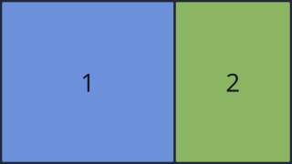 | 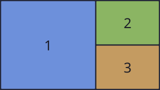 | 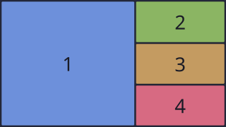 | 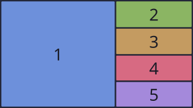 | 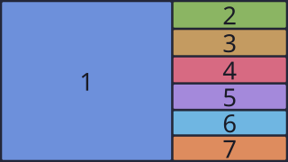 |
| `columns` |  |  | 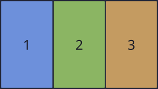 | 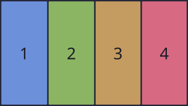 | 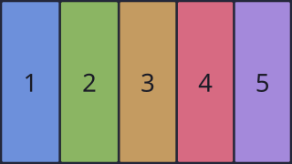 | 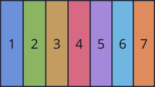 |
| `monocle` | 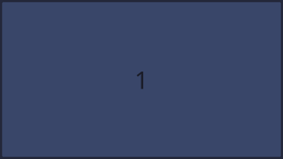 | 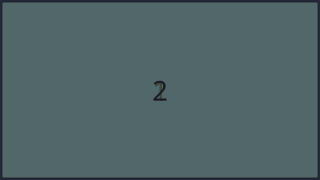 | 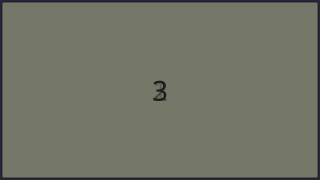 | 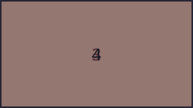 | 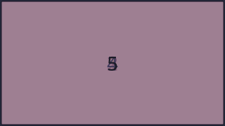 | 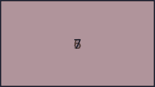 |
| `spiral` |  |  | 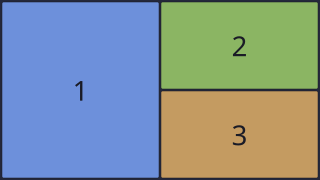 | 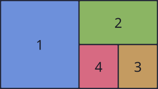 | 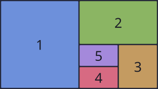 | 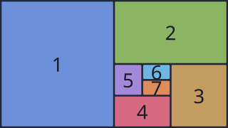 |
| `rows` | 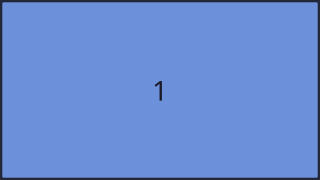 | 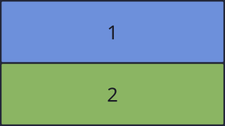 | 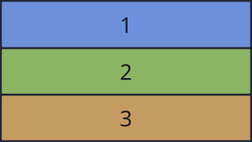 | 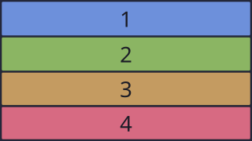 | 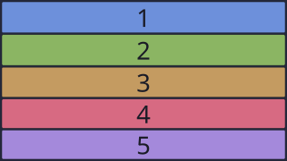 | 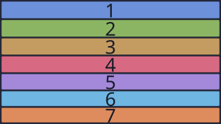 |
| `hstack` |  | 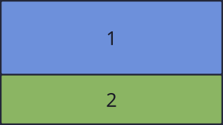 | 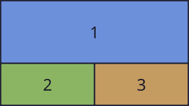 | 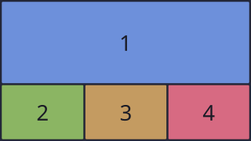 | 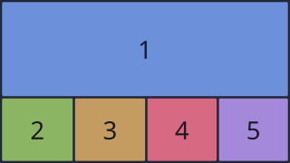 | 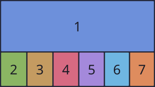 |
| `rmaster` |  | 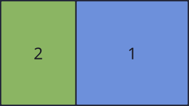 | 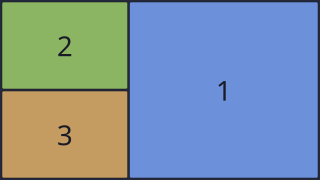 | 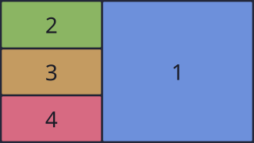 | 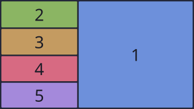 | 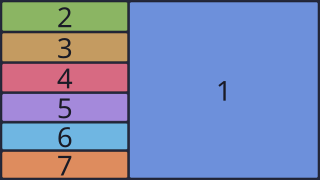 |
| `grid` |  | 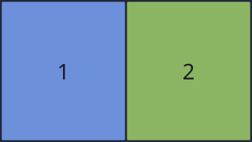 | 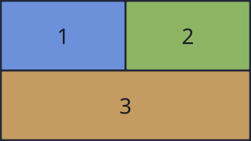 | 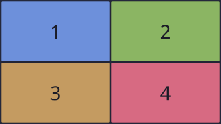 | 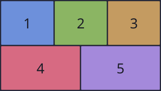 | 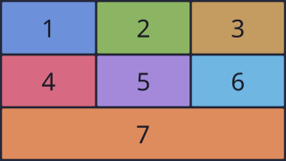 |
| `ultrawide` |  |  | 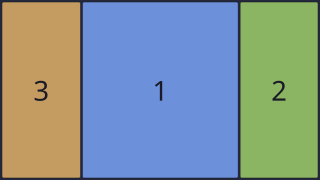 | 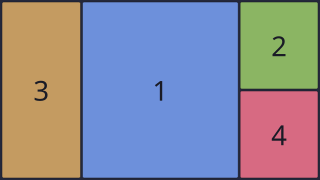 | 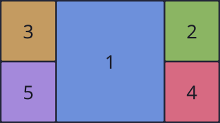 | 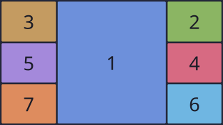 |

Regenerate with `node core/tools/render-layouts.js` (no dependencies).
